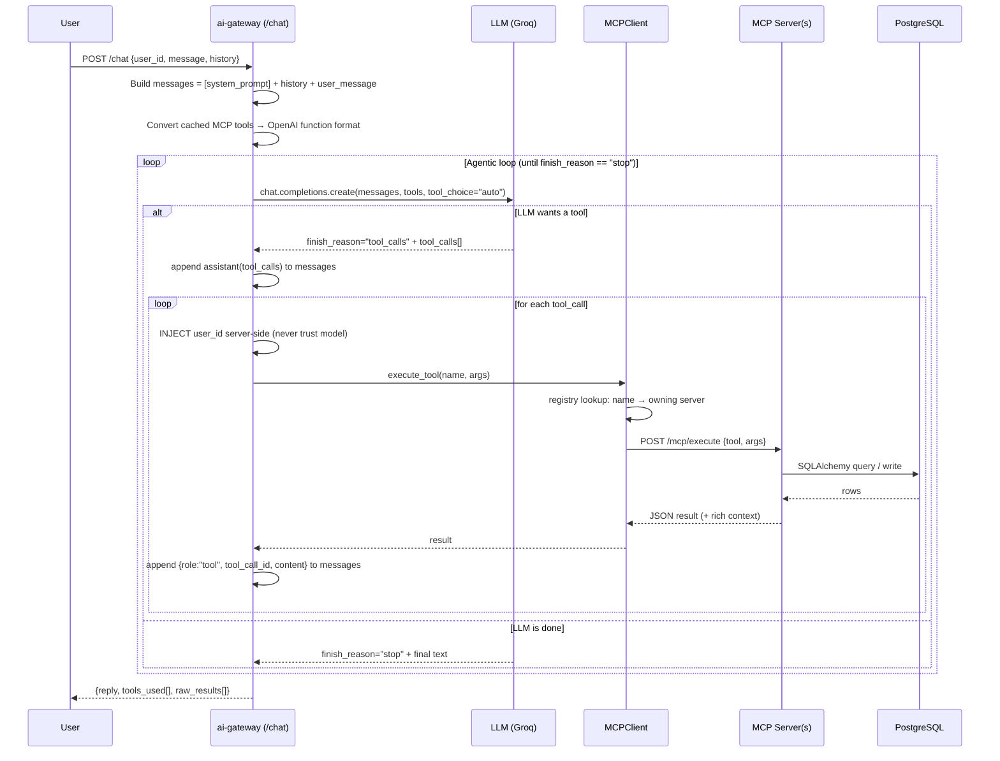
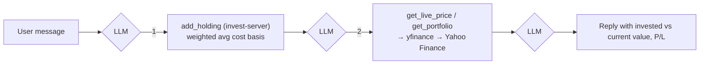

# FinTrack — Deep Dive & Interview Prep

> **Agentic Personal-Finance OS** built on the **Model Context Protocol (MCP)**.
> Role target: **AI Platform Engineer**.
>
> This document explains *what* the system is, *how* it executes end-to-end, *which
> technology sits where and why*, and gives you **ready-to-say answers** plus
> **worked query walkthroughs** you can narrate confidently in an interview.

---

## 0. The 30-Second Pitch (say this first)

> "FinTrack is an **agentic personal-finance assistant**. A user types a plain-English
> message like *'spent 250 on zomato lunch'*. A central **AI-gateway** sends that message
> plus a catalog of tools to an **LLM**. The LLM decides which tools to call, and the gateway
> **routes each tool call over HTTP to one of five independent MCP tool-servers** —
> expense, budget, invest, insights, goals. Each server owns its own domain logic and its
> slice of a shared **PostgreSQL** database. The gateway runs an **agentic loop**: call model →
> execute tool(s) → feed results back → repeat until the model produces a final natural-language
> reply. It's a **microservices + LLM-orchestration** architecture — the LLM is the brain, the
> MCP servers are the hands, and the gateway is the nervous system."

**One-liner tech stack:** Python · FastAPI · MCP (custom HTTP flavor) · OpenAI-compatible LLM (Groq) · PostgreSQL + SQLAlchemy (async / asyncpg) · Redis · Docker Compose · yfinance.

---

## 1. What Problem Does It Solve?

Young earners want to manage money by *talking*, not by filling forms. FinTrack lets them:

- **Log** expenses & income in natural language.
- **Set & track budgets** with proactive alerts.
- **Track investments** (stocks, MFs, crypto, FDs) with **live prices**.
- **Get insights** — trends, anomalies, forecasts, net worth, a financial health score.
- **Set & progress goals** — savings targets and spending habits.

The differentiator is **agentic orchestration**: one message can trigger a *chain* of tools
across *multiple* services, and the assistant weaves the results into one warm reply.

---

## 2. The Big Picture (architecture diagram)

```mermaid
flowchart TD
    U["User / Bruno / curl<br/>POST /chat"] --> GW

    subgraph GATEWAY["ai-gateway  :8000  (the orchestrator / brain)"]
      GW["FastAPI /chat endpoint<br/>+ Agentic tool loop"]
      MC["MCPClient<br/>tool discovery + routing"]
      GW <--> MC
    end

    GW -- "chat.completions.create()<br/>(OpenAI-compatible)" --> LLM["LLM Provider<br/>Groq · openai/gpt-oss-20b<br/>(swappable: Ollama, Gemini)"]
    LLM -- "tool_calls / final text" --> GW

    MC -- "POST /mcp/execute (HTTP)" --> S1
    MC -- "POST /mcp/execute (HTTP)" --> S2
    MC -- "POST /mcp/execute (HTTP)" --> S3
    MC -- "POST /mcp/execute (HTTP)" --> S4
    MC -- "POST /mcp/execute (HTTP)" --> S5

    subgraph SERVERS["5 Independent MCP Tool-Servers (the hands)"]
      S1["expense-server :8001<br/>log_expense, log_income,<br/>get_expenses, get_monthly_summary"]
      S2["budget-server :8002<br/>set_budget, check_budget_on_expense,<br/>get_budget_status, recommendations..."]
      S3["invest-server :8003<br/>add_holding, get_portfolio,<br/>get_live_price, log_sip..."]
      S4["insights-server :8004<br/>trends, anomalies, forecast,<br/>net_worth, health_score (READ-ONLY)"]
      S5["goals-server :8005<br/>create_goal, add_contribution,<br/>get_habit_status..."]
    end

    S1 --> PG[("PostgreSQL :5433→5432<br/>transactions · budgets · holdings<br/>sip_entries · goals · goal_contributions")]
    S2 --> PG
    S3 --> PG
    S4 --> PG

---

## 3. Technology — What, Where, and *Why*

This is the table interviewers love. Each row = a "why did you choose this" you can defend.

| Technology | Where it's used | Why it's there (the reasoning) |
|---|---|---|
| **Python 3.12** | Everywhere | Best ecosystem for LLM + data work; async support is mature. |
| **FastAPI** | ai-gateway + all 5 servers | Async-native, auto request validation via Pydantic, tiny boilerplate for JSON APIs. Every service is a FastAPI app. |
| **Uvicorn** | Every container's `command` | ASGI server that runs FastAPI; `--reload` gives hot code reload in dev. |
| **MCP (Model Context Protocol)** | Contract between gateway ↔ servers | The organizing principle: each server exposes tools via `/mcp/tools` (discovery) and `/mcp/execute` (invocation). Lets me add capabilities without touching the LLM prompt. |
| **OpenAI SDK (`openai`)** | ai-gateway → LLM | The LLM client. I use the **OpenAI-compatible** interface so the provider is swappable by env var. |
| **Groq (LLM host)** | Default provider | Free tier, extremely fast inference, OpenAI-compatible. Model: `openai/gpt-oss-20b` (supports tool calling). Ollama/Gemini are drop-in alternatives. |
| **PostgreSQL 16** | Shared datastore | Relational data (transactions, budgets, goals) with money math needs ACID + `NUMERIC`. One DB, logical ownership per service. |
| **SQLAlchemy 2.0 (async ORM)** | expense/budget/invest/goals | Models map Python classes → tables; `create_all` auto-creates schema on startup (no manual migrations for this phase). |
| **asyncpg** | DB driver | High-performance **async** Postgres driver — pairs with FastAPI's async model so DB I/O never blocks the event loop. |
| **Redis 7** | Infra (provisioned) | Stood up in compose with a healthcheck; intended for caching (e.g. live prices) / future session state. *(Be honest: wired into infra, not yet into app code.)* |
| **httpx (async)** | ai-gateway MCPClient | Async HTTP client the gateway uses to call MCP servers over the Docker network. |
| **yfinance** | invest-server | Free Yahoo Finance wrapper for **live** stock/ETF/crypto prices — the "tool that calls an external API" example. |
| **Pydantic v2** | All services | Request/response validation + typed schemas; catches bad input before it hits the DB. |
| **Docker + Docker Compose** | Whole system | 8 containers (5 servers + gateway + postgres + redis) on one private network, one `up` command. |
| **Bruno** | Manual API testing | Lightweight API client (like Postman) to hit `/chat` and `/mcp/*` endpoints. |

### 3.1 What is MCP — and how *this* project uses it

**MCP (Model Context Protocol)** is a standard way to expose "tools" (functions) to an LLM so
it can discover and call them. The core idea: **separate the reasoning (LLM) from the
capabilities (tools)**, behind a uniform contract.

This project implements an **HTTP flavor of MCP** with two endpoints per server:

```
GET  /mcp/tools     → returns tool definitions (name, description, JSON-Schema of args)
POST /mcp/execute   → body {"tool": "<name>", "args": {...}} → runs it, returns JSON
```

Why this matters (say this in the interview):
> "MCP gives me a **plug-in architecture for LLM capabilities**. Each server advertises its
> tools as JSON Schema. The gateway aggregates all of them into one catalog and hands it to the
> model. To add a whole new capability — say a 'tax-server' — I spin up a new FastAPI service,
> register its URL in the gateway's `MCPClient`, and the model **automatically discovers and
> uses its tools with zero prompt changes.** That decoupling is the whole point."

### 3.2 Why 5 servers instead of one app? (microservices rationale)

- **Separation of concerns** — each domain (expenses, budgets, investing, insights, goals) evolves independently.
- **Independent scaling** — the live-price server (external API latency) can scale separately from logging.
- **Fault isolation** — if invest-server (Yahoo Finance) is down, expense logging still works; the gateway just warns that server is unreachable.
- **Clear tool ownership** — the gateway's registry maps every tool name → its owning server.

    S5 --> PG

    S3 -- "live prices" --> YF["Yahoo Finance<br/>(yfinance)"]

    R[("Redis :6379<br/>provisioned for caching")]:::infra
    classDef infra fill:#eee,stroke:#999,stroke-dasharray: 4 4;
```

---

## 4. The Execution Flow — How a Request Actually Runs

### 4.1 Startup (what happens on `docker compose up`)

```
1. postgres + redis boot → healthchecks pass.
2. Each MCP server boots → lifespan() calls init_db():
     - expense/budget/invest/goals: SQLAlchemy Base.metadata.create_all → CREATE TABLE IF NOT EXISTS
     - insights: init_db() is a NO-OP (it owns no tables — read-only analytics service)
3. ai-gateway boots → lifespan() calls MCPClient.discover_tools():
     - GET /mcp/tools on all 5 servers (with retry/backoff for the startup race)
     - builds _tool_registry:  { "log_expense": "expense-server", ... }  (name → owner)
     - caches all ~29 tool definitions in memory (_cached_tools)
4. Gateway prints: "✅ ai-gateway ready — 29 tools cached | model: openai/gpt-oss-20b"
```

> **Interview nugget:** tool discovery is cached **once at startup**, not per request — so the
> hot path (`/chat`) has zero discovery overhead. `discover_tools()` has **retry logic** because
> the gateway may start before servers finish creating tables (a classic distributed-startup race).

### 4.2 The `/chat` request lifecycle (the agentic loop) — the heart of the system



### 4.3 The loop, in words (memorize these 6 beats)

1. **Assemble context** — `messages = [SYSTEM_PROMPT] + history + current user message`.
   Convert cached MCP tools → OpenAI function-calling format (rename `input_schema` → `parameters`).
2. **Ask the model** — `client.chat.completions.create(model, messages, tools, tool_choice="auto")`.
   `"auto"` = the model decides whether to call tools or answer directly.
3. **Branch on `finish_reason`:**
   - `"stop"` → model produced a final reply → **return it**. Loop ends.
   - `"tool_calls"` → model wants tools → continue.
4. **Execute each tool call:** append the assistant's tool-call message; for each call:
   - **Inject `user_id` server-side** (security — never trust the value the model emits).
   - `MCPClient.execute_tool()` → registry maps tool name → owning server → `POST /mcp/execute`.
   - Append the JSON result as a `{"role": "tool", "tool_call_id": ...}` message.
5. **Loop back** — the model now sees tool results and either calls more tools or finalizes.
6. **Respond** — return `{reply, tools_used, raw_results}`. `tools_used` is your audit trail of the chain.

> **Why a loop and not one call?** Because one user message can require **multiple, dependent**
> tool calls (log → check budget → check habit). The model reasons *between* steps. This is what
> makes it **agentic** rather than a single function call.


**Three roles to memorize:**


---

## 5. Sample Queries — What Executes, How, and When

These are the walkthroughs to rehearse. Each shows the **input**, the **tool chain**, and **why**.

### Query A — "spent 250 on zomato lunch"  *(single-server → then cross-server chain)*


**Step-by-step:**
1. LLM extracts `{amount:250, category:"food", merchant:"zomato", description:"lunch"}` → calls `log_expense`.
   - expense-server inserts a `Transaction` row (UUID id, `NUMERIC` amount) and returns **rich `monthly_context`**: category spend this month, total spend, burn rate, projected month spend, days elapsed/remaining. *(This context is deliberate — it gives the LLM data to reason about without extra calls.)*
2. The **SYSTEM_PROMPT rule** ("after EVERY log_expense, call check_budget_on_expense") makes the LLM call `check_budget_on_expense(category=food)` on **budget-server**. That server queries the shared `transactions` table (raw SQL with `::text` enum casts) to compute % of budget used → returns an `alert_level` (`ok`/`warning`/`danger`/`exceeded`).
3. Another rule triggers `get_habit_status` on **goals-server** to see if a food-habit goal is at risk.
4. LLM composes one reply, tone shaped by `alert_level`. Returns with `tools_used = [log_expense, check_budget_on_expense, get_habit_status]`.

> This is the flagship demo — **one message, three tools, three different servers, one coherent reply.**

### Query B — "how am I doing this month?"  *(single tool, read path)*

- LLM → `get_monthly_summary(user_id)` on **expense-server**.
- Server runs grouped SQL aggregates: income, spend by category, savings, savings-rate %, top category.
- LLM narrates: *"You've spent ₹X of ₹Y income, saving Z% — your biggest category is food."*

### Query C — "set my food budget to 5000"  *(write with upsert)*

- LLM → `set_budget(category=food, monthly_limit=5000)` on **budget-server**.
- Uses PostgreSQL **UPSERT** (`INSERT ... ON CONFLICT (user_id, category) DO UPDATE`) so re-setting a budget updates instead of duplicating (enforced by `uq_user_category` unique constraint).

### Query D — "I bought 10 shares of Reliance at 2900, what's it worth now?"  *(external API)*



- `add_holding` computes **weighted average buy price** if the symbol already exists (handles "bought more").
- `get_live_price` is special: **no DB, no user_id** — a pure external call to Yahoo Finance via `yfinance`. FDs return `None` (no market price). This is the "tool that reaches outside the system" example.

### Query E — "I want to save ₹50,000 for a MacBook by December"  *(intent → goal)*

- SYSTEM_PROMPT rule 4: on any savings intent, **immediately** call `create_goal` with sensible defaults (no clarifying questions).
- goals-server creates a `savings` goal; later `add_goal_contribution` deposits accumulate, and `_compute_savings_progress()` derives `required_monthly`, `on_track`, and a `status_label` (`on_track`/`behind`/`at_risk`) the LLM uses to set tone.

### Query F — "am I spending more than usual?"  *(analytics, read-only server)*

- LLM → `detect_anomalies` / `get_spending_trends` on **insights-server**.
- insights-server **owns no tables** — it reads `transactions`, `budgets`, `holdings` via raw SQL and computes month-over-month trends, flags categories >50% above the 3-month average, forecasts, net worth, and a health score.

### Query G — "hi"  *(no tool at all)*

- `tool_choice="auto"` lets the model reply directly with `finish_reason="stop"` on the **first** iteration. **Zero tool calls.** Good to mention: the model isn't forced to use tools.

| Layer | Component | Analogy | Responsibility |
|---|---|---|---|

---

## 6. The Data Model (PostgreSQL, shared DB)

One database, **logical ownership per service**. Tables auto-created by SQLAlchemy on startup.

| Table | Owner server | Key columns | Notes |
|---|---|---|---|
| `transactions` | expense | id(UUID), user_id, type(expense/income), amount(NUMERIC), category(enum), merchant, transaction_at | Point-in-time money events |
| `budgets` | budget | id, user_id, category, monthly_limit, alert_threshold_pct | Unique `(user_id, category)` → upsert |
| `holdings` | invest | id, user_id, symbol, asset_type, quantity, avg_buy_price, total_invested | Weighted avg cost basis |
| `sip_entries` | invest | id, user_id, symbol, amount, sip_date | Monthly SIP history |
| `goals` | goals | id, user_id, title, goal_type(savings/habit), target_amount, current_amount, deadline, habit_limit | Persists across months |
| `goal_contributions` | goals | id, goal_id(FK→goals), amount, note | Deposit history per goal |

**Design details worth naming:**
- **`NUMERIC(12,2)`** for money — never floats (avoids rounding errors in currency).
- **`native_enum=False`** on enum columns — stores enums as short strings + CHECK constraint instead of a Postgres `ENUM` type. This **avoids a name-collision bug** when two independent services both define a `category` enum on the same shared DB.
- **Cross-server reads use raw SQL with `::text` casts** — budget/insights servers read `transactions` (a table they don't *own*) with `category::text = :category`, because comparing a native-enum column to a plain string bind param silently returns no rows without the cast.

### Server ↔ Tools ↔ Table quick map

```
expense-server  (8001) │ log_expense, log_income, get_expenses, get_monthly_summary        → transactions
budget-server   (8002) │ set_budget, get_budget_status, get_all_budgets,                    → budgets
                       │ check_budget_on_expense, update_budget, delete_budget,             (reads transactions)
                       │ get_budget_recommendations
invest-server   (8003) │ add_holding, get_portfolio, get_live_price, log_sip,               → holdings, sip_entries
                       │ get_sip_summary, get_asset_allocation                              (+ Yahoo Finance)
insights-server (8004) │ get_spending_trends, detect_anomalies, get_month_forecast,         READ-ONLY: reads
                       │ get_net_worth, get_financial_health_score                          transactions/budgets/holdings
goals-server    (8005) │ create_goal, get_goals, add_goal_contribution, get_goal_detail,    → goals, goal_contributions
                       │ update_goal, complete_goal, get_habit_status
```

---

## 7. Key Design Decisions (defend these)

1. **Provider-agnostic LLM layer.** The gateway talks to *any* OpenAI-compatible endpoint. Switching Groq → Ollama → Gemini is **three env vars, zero code**. *(Note: my resume says "Claude API"; the code now uses this OpenAI-compatible layer with Groq — I'd reconcile that wording.)*
2. **BYOK-capable.** Provider key lives in `.env` (was previously per-request), so the app can be hosted without embedding a paid key.
3. **`user_id` injected server-side in the loop, never trusted from the model.** Even though the system prompt tells the model not to ask for it, the gateway *forcibly overwrites* `args["user_id"]` before every tool call — a security boundary.
4. **Tool discovery cached at startup with retry/backoff.** Handles the distributed-startup race; keeps the hot path fast.
5. **Rich context returned by tools.** `log_expense` returns monthly totals/burn-rate so the LLM reasons in one pass instead of making extra calls — reduces loop iterations (latency + token cost).
6. **Behavior lives in the SYSTEM_PROMPT, not hardcoded logic.** Chaining rules ("always check budget after logging") are prompt instructions — flexible, but I can discuss making them deterministic if reliability matters.
7. **insights-server is intentionally read-only** — a pure analytics/aggregation service with no tables of its own.

---

## 8. Honest Limitations (say these before they ask — it reads as senior)

- **Persistent memory is request-scoped.** Conversation `history` is passed in by the caller; there's no server-side long-term memory store yet (Redis is provisioned but not yet used for this). *This is my next milestone.*
- **No auth/multi-tenant isolation yet** — `user_id` is trusted from the request body; production needs JWT/auth (deps are already in `requirements.txt`).
- **Chaining relies on prompt-following** — a smaller model may occasionally skip a step; a deterministic post-step could enforce it.
- **Shared-DB cross-service reads** couple services at the schema level; at scale I'd move to service-to-service HTTP or an event/read-model.
- **No automated tests / CI** yet; validation is currently manual via Bruno.
- **Single commit + 3 servers untracked in git** — housekeeping to do (and keep the `.env` key out of git).

| **Brain** | LLM (Groq) | Decides *what* to do | Reads message + tool catalog, picks tools, writes final reply |
| **Nervous system** | ai-gateway | Wires everything | Discovers tools, runs agentic loop, routes calls, manages memory |
| **Hands** | 5 MCP servers | Do *how* to do it | Domain logic + DB access + external APIs |


---

## 9. Likely Interview Q&A (rapid-fire)

**Q: What makes this "agentic"?**
> A loop where the LLM chooses tools, sees their results, and decides the next action — multi-step reasoning, not a single function call. It ends when the model emits `finish_reason="stop"`.

**Q: What exactly is MCP here?**
> A uniform tool contract: every server exposes `GET /mcp/tools` (discovery, JSON-Schema) and `POST /mcp/execute` (invocation). The gateway aggregates all tools into one catalog for the model and routes calls by a name→server registry.

**Q: How does the gateway know which server owns a tool?**
> At startup, `MCPClient.discover_tools()` builds `_tool_registry = {tool_name: server_name}`. `execute_tool()` looks up the owner and POSTs to its `/mcp/execute`.

**Q: How do you add a new capability?**
> New FastAPI service implementing the two MCP endpoints → add its URL to `MCPClient.servers` → restart gateway. The model auto-discovers it. **No prompt changes.**

**Q: Sync or async? Why?**
> Async end-to-end: FastAPI + `asyncpg` + `httpx.AsyncClient`. DB and inter-service HTTP are I/O-bound, so async keeps the event loop free and lets one worker handle many concurrent requests.

**Q: Why microservices over a monolith?**
> Separation of concerns, independent scaling (esp. the external-API invest-server), fault isolation, and clean tool ownership. Trade-off: operational complexity + the current shared-DB coupling.

**Q: How do services communicate?**
> Gateway → servers over **HTTP** on Docker's private network (service-name DNS, e.g. `http://expense-server:8001`). Servers reach Postgres/Redis by service name too.

**Q: Where does Redis fit?**
> Provisioned in compose with a healthcheck and `REDIS_URL` injected everywhere; intended for caching (e.g. live prices) and future session/memory. Honest: infra is ready, app wiring is a next step.

**Q: How do you handle failures?**
> Discovery retries with backoff; per-tool try/except returns `{"error": ...}` rather than crashing the loop; the gateway maps LLM errors to HTTP codes (429 rate-limit, 401/403 bad key, others surfaced).

**Q: Security concerns?**
> `user_id` is force-injected server-side; provider key is server-side in `.env`; CORS is currently open (`*`) and there's no auth yet — both flagged for production.

**Q: What was a real bug you fixed?**
> (1) Postgres enum collision on the shared DB → fixed with `native_enum=False`. (2) Cross-service enum comparisons returning empty → fixed with `::text` casts. (3) Groq deprecated the Llama chat models to Enterprise-only → switched `AI_MODEL` to `openai/gpt-oss-20b` (a tool-calling model my key can access); learned env changes need `docker compose up -d`, not `restart`.

---

## 10. How to Run & Demo It

```bash
cd "/Users/i749349/Desktop/MCP PROJECT/FinTrack"

# 1. Start Docker Desktop (the daemon), then bring up all 8 containers:
docker compose up --build            # first time / after code changes
# (env var changed? recreate, don't just restart:)  docker compose up -d

# 2. Verify the gateway sees all servers/tools:
curl http://localhost:8000/health | python3 -m json.tool
#   -> status ok, tools_count 29, model openai/gpt-oss-20b

# 3. Peek at one server's tool catalog:
curl http://localhost:8001/mcp/tools | python3 -m json.tool

# 4. The full demo -- natural language in, agentic chain out:
curl -X POST http://localhost:8000/chat \
  -H "Content-Type: application/json" \
  -d '{"user_id":"u_ayush","message":"spent 250 on zomato lunch"}'
#   -> reply + tools_used:[log_expense, check_budget_on_expense, get_habit_status]

# Useful:
docker compose ps                    # health of all services
docker compose logs -f ai-gateway    # watch the loop print tool calls live
docker compose down                  # stop (add -v to wipe the DB volume)
```

**Ports cheat-sheet:** gateway `8000` · expense `8001` · budget `8002` · invest `8003` · insights `8004` · goals `8005` · Postgres host `5433`→container `5432` · Redis `6379`.

---

## 11. Resume Bullet ↔ Code Mapping (so you never get caught out)

| Resume claim | Where it lives in the code |
|---|---|
| "multi-agent, BYOK platform on MCP, 5 tool-servers" | `mcp-servers/*` (5 dirs), each with `/mcp/tools` + `/mcp/execute`; key in `.env` |
| "coordinated by a central AI-gateway" | `ai-gateway/main.py` + `mcp_client.py` |
| "orchestrator as an LLM-driven harness … cross-server tool chaining" | the `while True` agentic loop in `main.py`; SYSTEM_PROMPT chaining rules |
| "persistent agent context/memory across requests" | `history` in `ChatRequest` (request-scoped today; Redis-backed memory is the next step — say so) |
| "Claude API" | ⚠️ code now uses an **OpenAI-compatible** client on **Groq**; the layer *can* target Claude — reconcile the wording |
| "async" | FastAPI + `asyncpg` + `httpx.AsyncClient` throughout |

> **Rehearsal tip:** narrate Query A (§5.A) end-to-end, then say "and here's the loop that powers it"
> and walk §4.3. If they push, pull one honest limitation from §8 and explain how you'd fix it.

